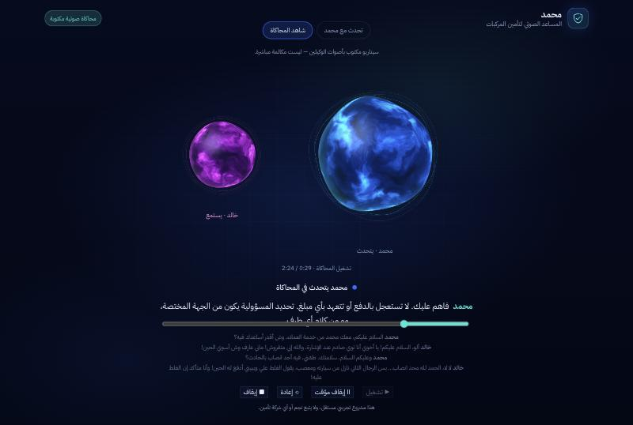
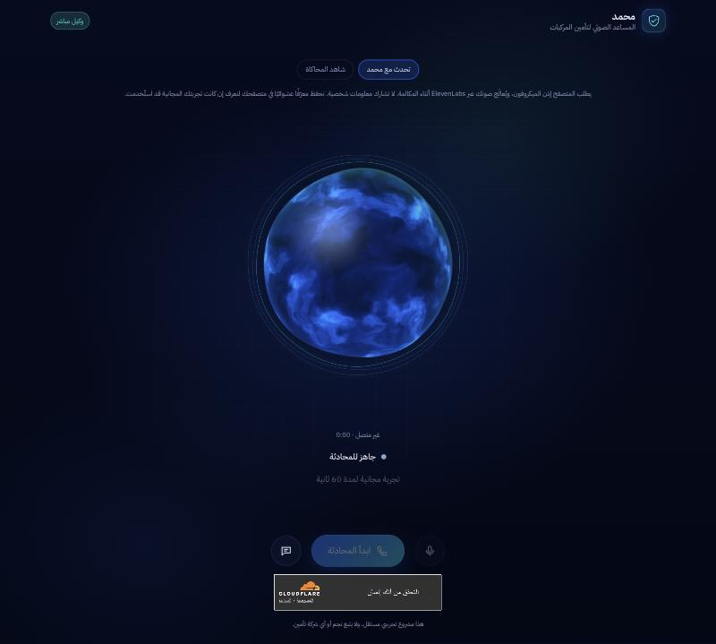
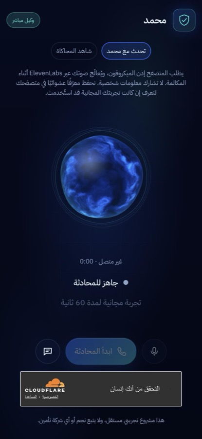
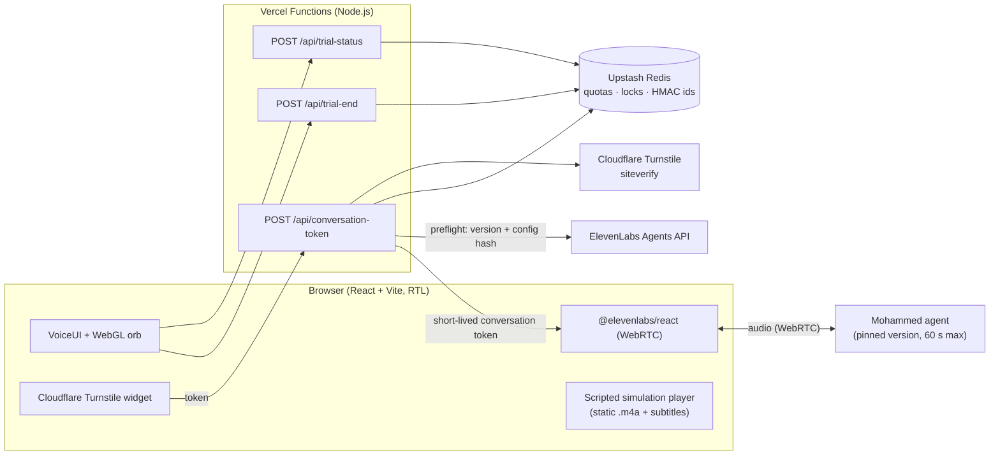
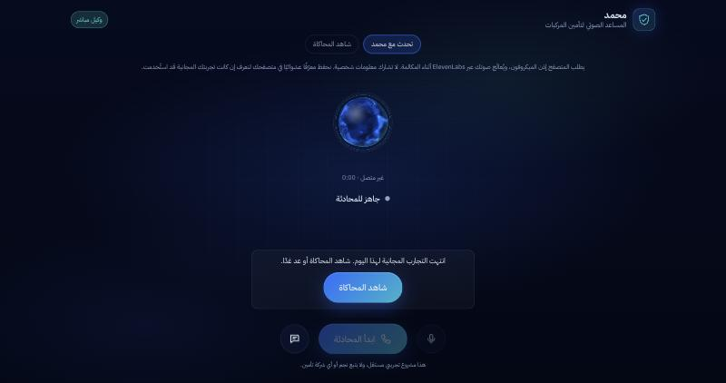

# Mohammed — Saudi Arabic AI Voice Agent

A real-time, Saudi-dialect voice agent that helps drivers through the first minutes after a car accident, built as an AI-engineering portfolio project.

**Live demo:** https://mohammed-voice-ai.vercel.app

> **Disclaimer:** this is an independent demonstration project. "Mohammed" is a fictional assistant for a fictional insurer. The project is not affiliated with, endorsed by, or acting for Najm or any insurance company, and it gives no real insurance, legal or safety advice.



---

## Project overview

Mohammed is a voice agent that speaks natural Saudi Arabic (Najdi dialect). The scenario is a driver who has just been in a minor collision and calls their insurer in a panic. Mohammed:

- calms the caller and puts their safety first (moving away from traffic, hazard lights, warning triangle);
- asks the right follow-up questions (injuries, location, whether the policy is active);
- explains the next steps (report the accident to the competent authority, keep ID, licence and vehicle registration ready);
- never commits to amounts, liability or claim outcomes.

The site has two modes, always reachable from the top navigation:

| Tab | What it is | Cost |
|---|---|---|
| **«تحدث مع محمد» — Talk to Mohammed** | A live, two-way voice call with the agent in the browser (WebRTC). Public visitors get **one free 60-second trial**. | Paid per call, protected by bot checks and quotas |
| **«شاهد المحاكاة» — Watch the simulation** | A 2 min 24 s **scripted dramatization** between Mohammed and an AI-voiced caller, Khalid, with synchronized subtitles. It is clearly labelled as scripted, not a live call. | Free (static audio file) |

## Live demo

- **Site:** https://mohammed-voice-ai.vercel.app
- **Simulation:** open the site and press **▶ تشغيل** (works without a microphone).
- **Live trial:** choose **تحدث مع محمد**, pass the Cloudflare check, allow the microphone and press **ابدأ المحادثة**. The call ends automatically after 60 seconds. Each browser gets one trial.

| Live trial (desktop) | Live trial (mobile) |
|---|---|
|  |  |

## Key features

- **Real-time Arabic voice conversation:** ElevenLabs Agents over WebRTC, with live transcript, mute, and an audio-reactive WebGL orb that shows *listening*, *thinking* and *speaking* states.
- **Saudi-dialect persona:** prompt and voice tuned for natural Najdi phrasing, short spoken turns, and numbers spoken as words.
- **Public free trial with hard cost limits:** 60-second calls enforced by the provider, one trial per visitor, global daily and monthly caps, one concurrent call, and Cloudflare Turnstile.
- **Graceful limits:** if the visitor has already used their trial, or a daily, monthly or network limit is reached, the page says so in Arabic and offers a prominent «شاهد المحاكاة» button. This happens before any bot check or microphone prompt.
- **Pinned, audited agent configuration:** the server only issues call tokens for one exact agent *version* whose configuration hash matches a reviewed value. Any remote drift makes it fail closed.
- **Scripted audio drama pipeline:** per-line TTS with timestamps, an offline JavaScript mixer (telephone band-pass for the caller, headset EQ, street ambience, adaptive ducking, a horn cutting into a sentence), subtitles derived from alignment data, and a deterministic 1080p video renderer.
- **RTL-first, responsive UI:** Arabic interface built with React, usable on phones.

## Architecture



**Call flow (live trial)**

1. The page asks the server whether this browser has already used its trial and whether any limit is already reached (`/api/trial-status`, read-only). The server identifies the browser by a signed, HttpOnly random cookie. If no trial is possible, the page shows a message and a «شاهد المحاكاة» button instead of the call controls.
2. The visitor presses Start. The browser asks for microphone permission **before** requesting a token, so a denied microphone never consumes a trial.
3. `/api/conversation-token` checks the request origin and verifies the Turnstile token server-side. It then reserves the trial atomically in Redis, checks the remote agent configuration, and returns a **short-lived conversation token**. The ElevenLabs API key never leaves the server.
4. The browser connects directly to the agent over WebRTC. ElevenLabs ends the call at 60 seconds. The UI shows a countdown and an end card.
5. `/api/trial-end` releases the concurrency lock. A session that never connected is refunded once.

**Project layout**

```
api/                 Vercel Function entry points (thin wrappers around server/)
server/              HTTP handler, origin/session security, trial quotas, ElevenLabs preflight
  simulator/         Internal AI-to-AI conversation simulator (not exposed publicly)
src/                 React app: VoiceUI, WebGL orb, live/recorded/simulated conversation hooks
public/recordings/   The approved scripted simulation audio
scripted-demo/       Script JSON, TTS generation, offline mixer, fixture builder, video renderer
scripts/             Build-time secret scan, render check, Vercel environment setup
tests/               Node test runner suites (security, quotas, mixer, UI rendering, …)
```

## Tech stack

| Area | Technology |
|---|---|
| Frontend | React 18.3, Vite 5.4, plain CSS (RTL), WebGL shader for the orb |
| Voice agent | ElevenLabs Agents (Conversational AI) via `@elevenlabs/react` 1.17 over WebRTC |
| Speech synthesis (simulation) | ElevenLabs Text-to-Speech `eleven_v4_turbo` with character timestamps |
| Backend | Node.js 22+ (`node:http` locally, Vercel Functions in production); no server framework |
| Rate limiting & state | Upstash Redis (REST API) |
| Bot protection | Cloudflare Turnstile (server-side verification) |
| Hosting | Vercel (Deployment Protection on previews) |
| Audio production | Custom JavaScript DSP (biquad filters, resampling, ducking), `afconvert` (AAC) |
| Video export | Headless Chrome with a virtual clock and a Swift AVFoundation encoder (H.264, 1080p) |
| Internal simulator | Anthropic Messages API (drives the AI caller in AI-to-AI test calls) |
| Testing | Node.js built-in test runner (`node --test`) |

## Security and rate limiting

Live voice calls cost money per minute, so the public trial has **several independent limits**, enforced on the server and at the provider:

| Control | Where it is enforced |
|---|---|
| 60-second maximum call length | ElevenLabs agent setting (`max_duration_seconds = 60`) on the pinned version. The server refuses to issue tokens for any version that allows longer calls. |
| One trial per visitor | Signed HttpOnly cookie with a random id, stored in Redis only as an HMAC (400-day record) |
| 5 trials per network per 24 h | HMAC of the client IP (raw IPs are never stored) |
| 5 calls per day, 30 per month (site-wide) | Atomic Redis `INCR` with full rollback on any failure |
| One call at a time | Redis lock (`SET NX EX`) |
| Bot protection | Cloudflare Turnstile, verified server-side before any quota is touched |
| Origin checks | Exact-match allow-list (no wildcards). `Host` / `X-Forwarded-Host` headers are ignored. |
| Configuration drift | Calls are pinned to one agent version and its reviewed configuration hash |
| Fail closed | No Redis or no Turnstile secret on Vercel means no calls |

Other safeguards:

- **No secrets in the browser:** the build runs `scripts/check-secrets.mjs`, which fails the deployment if any configured secret value, private-key pattern, or secret-looking `VITE_*` variable appears in the frontend bundle.
- **Minimal data:** no accounts, names or emails. Redis holds only HMACs and counters. The site itself stores no audio or transcripts. Call audio is processed by ElevenLabs under the agent's own data-retention settings, and visitors are told not to share personal information.
- **Explicit opt-ins:** live sessions require `LIVE_SESSIONS_APPROVED`, `AGENT_SAFETY_REVIEWED` and `PERSONAL_PROJECT_CREDENTIALS`, all off by default.

## Local setup

**Requirements:** Node.js 22 or newer, npm.

```bash
git clone https://github.com/<your-account>/mohammed-ai-voice-agent.git
cd mohammed-ai-voice-agent
npm install
```

**Simulation only (no keys, no cost):**

```bash
npm run dev
# open http://127.0.0.1:5173/?mode=recorded
```

**Live voice mode (your own ElevenLabs account):**

```bash
cp .env.example .env    # fill in your own keys and agent ids; .env is git-ignored
npm run token-server    # terminal 1: local API on 127.0.0.1:8787 (reads ./.env only)
npm run dev             # terminal 2: open http://127.0.0.1:5173/?mode=live
```

For a local public-trial setup without Redis or Turnstile, set `PUBLIC_TRIAL=true`, `VITE_PUBLIC_TRIAL=true` and `TURNSTILE_DISABLED=true`. An in-memory quota store is then used. Both fallbacks are refused when running on Vercel.

**Tests and checks:**

```bash
npm test                # unit and integration tests
npm run verify          # tests + render check + production build + secret scan
```

## Screenshots

| | |
|---|---|
|  |  |
| Scripted simulation with synchronized subtitles | Live trial page before a call (Turnstile check shown) |
|  | |
| Daily limit reached: an Arabic message and a «شاهد المحاكاة» button | |

## Limitations

- **"One trial per visitor" is per browser, not per person.** Without user accounts, a new browser, device or cleared cookies counts as a new visitor. The network, daily and monthly caps bound the total cost.
- **Arabic only.** The agent, voice and UI are built for Saudi Arabic. Other dialects or languages are not tuned.
- **Not a real insurance service.** The agent has no access to policies or claims systems and does not file reports. It only guides the caller through general first steps.
- **Provider dependence.** Voice quality, latency and limits depend on ElevenLabs. Speech recognition can mishear noisy or fast speech.
- **The simulation is scripted.** «شاهد المحاكاة» is a written dramatization voiced with TTS. It is not a recording of a real call.
- **Internal tooling is not included.** Scripts that create, publish and audit the private ElevenLabs agents, prompt drafts and internal notes are kept out of this repository, because they contain account-specific identifiers. The public web app, its server, the scripted-demo pipeline and their tests are complete.

## Disclaimer

This repository and the live site are an **independent portfolio demonstration**. All companies, people and conversations in the demo are fictional. The project is **not affiliated with, endorsed by or operated for Najm, any insurance company or any government authority**. Nothing in it is insurance, legal or road-safety advice. In a real emergency, contact the competent authorities.

No real customer data is used. The simulation's sound effects come from the Mixkit Free License and Freesound CC0 libraries. Sources are listed in [`scripted-demo/sfx-licenses.json`](scripted-demo/sfx-licenses.json).

## License

No open-source license has been chosen yet. Until one is added, all rights are reserved.
